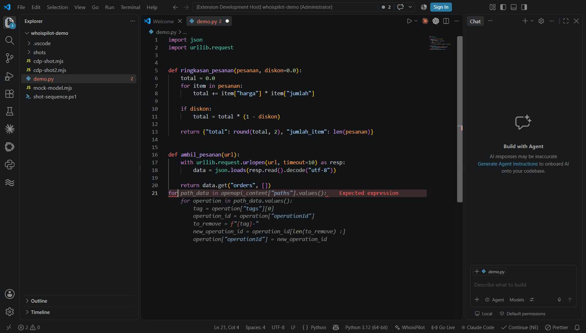
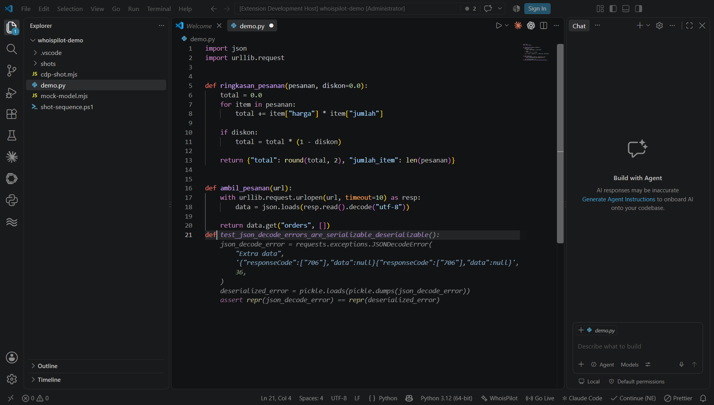
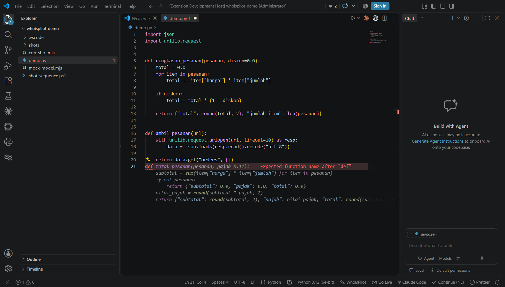
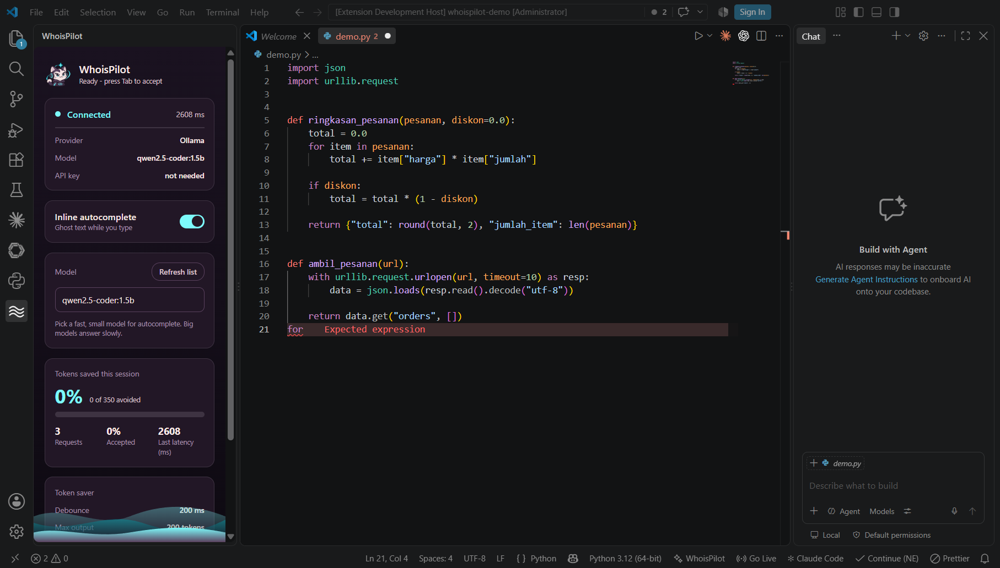

# WhoisPilot

Fast inline AI autocomplete for VS Code. Gray "ghost text" appears as you type, **Tab** accepts it. Bring your own model: sign in with your ChatGPT plan, or use an API key for OpenAI, DeepSeek, Anthropic, Gemini, Mistral, Groq, OpenRouter, Ollama, or any OpenAI-compatible URL.

> Not affiliated with, endorsed by, or derived from GitHub, Microsoft, OpenAI or Anthropic. "GitHub Copilot" and the other names are trademarks of their owners.
> Status: early (v0.1). It works in daily use, but expect rough edges (see [Known limitations](#known-limitations)).




| Instant block, offline (typing `def`) | The model then rewrites it for your file |
|---|---|
|  |  |



## What it does

- **Ghost-text completions in every language**, multi-line when the cursor is at the end of a line (whole `if`/`for`/function/element), one line when you edit in the middle of a line.
- **Instant blocks of real code.** Type the first letters of a construct (`i`, `for`, `<t`) and a whole block of real open-source code (from [`media/dataset`](media/dataset), mined from MIT/Apache/BSD repositories) appears at once, offline. The model then rewrites it for **your** file and replaces it. If the code just above the cursor already has variables the block cannot use (for example `int nilai; string keterangan;`), no instant block is shown and you get the model's answer instead.
- **No restart per keystroke.** The model call that starts at an empty line keeps running while you type the first letters; if what you type matches the start of its answer, the rest appears immediately (a "typing cache").
- **Uses your other open files** (opt-out): up to two ~500-character snippets that share names with the code at the cursor, so suggestions reuse your helpers.
- **Cuts at block boundaries** and drops looping answers instead of showing half a line.
- **Your own rules**: `customInstructions`, per-language `languageInstructions`, and your own instant templates.

## Languages

Ghost text works in **any** language VS Code knows (anything with a language id) — nothing is hard-coded per language. The icons below are the languages with tested instant blocks in [`media/dataset`](media/dataset); the rest still get model completions.

<table>
<tr>
<td align="center" width="72"><br><sub>Python</sub></td>
<td align="center" width="72"><br><sub>JavaScript</sub></td>
<td align="center" width="72"><br><sub>TypeScript</sub></td>
<td align="center" width="72"><br><sub>Java</sub></td>
<td align="center" width="72"><br><sub>Go</sub></td>
<td align="center" width="72"><br><sub>Rust</sub></td>
<td align="center" width="72"><br><sub>PHP</sub></td>
<td align="center" width="72"><br><sub>Ruby</sub></td>
<td align="center" width="72"><br><sub>C#</sub></td>
</tr>
<tr>
<td align="center" width="72"><br><sub>C</sub></td>
<td align="center" width="72"><br><sub>C++</sub></td>
<td align="center" width="72"><br><sub>CSS</sub></td>
<td align="center" width="72"><br><sub>HTML</sub></td>
<td align="center" width="72"><br><sub>Shell</sub></td>
<td align="center" width="72"><br><sub>Lua</sub></td>
<td align="center" width="72"><br><sub>Kotlin</sub></td>
<td align="center" width="72"><br><sub>Swift</sub></td>
<td align="center" width="72"><br><sub>+60 more</sub></td>
</tr>
</table>

Icons: [Simple Icons](https://simpleicons.org) (CC0 1.0); brand marks belong to their owners.

## Install (from source)

```bash
git clone https://github.com/aocslabs/whoispilot.git
cd whoispilot
npm ci
npm run compile
```

Then either press **F5** in VS Code (Extension Development Host), or build an installable file:

```bash
npx @vscode/vsce package
code --install-extension whoispilot-0.1.0.vsix
```

Requires VS Code 1.90+ and Node 20+ (for building). Before publishing to the Marketplace, change `publisher` in `package.json` and add a `repository` URL.

## Sign in

Open the **WhoisPilot** icon in the activity bar.

- **Continue with ChatGPT** — uses OpenAI's *Sign in with ChatGPT* flow for open-source tools (OAuth with PKCE on a `127.0.0.1` callback, no client secret). Requests count toward your ChatGPT plan. OpenAI describes this as a preview for eligible plans, and it is intended for open-source tools; check [their terms](https://developers.openai.com/siwc/token-sharing-open-source) before relying on it. Tokens are kept in VS Code's SecretStorage.
- **Bring your own API key** — pick a provider (or *Custom*), check Base URL and Model, paste the key. Keys are kept in SecretStorage, never in settings.json.

The model list is fetched from the provider. For the ChatGPT sign-in, **Auto: fastest** times each model once and keeps the quickest; you can also pick one by hand.

## Settings (most useful)

| Setting | Default | What it does |
|---|---|---|
| `whoispilot.provider` | `deepseek` | `chatgpt`, `openai`, `deepseek`, `anthropic`, `gemini`, `mistral`, `groq`, `openrouter`, `ollama`, `custom` |
| `whoispilot.model` / `baseUrl` | provider default | Override the model / endpoint |
| `whoispilot.mode` | `auto` | `fim` (prefix+suffix, cheapest), `chat`, or `responses` |
| `whoispilot.maxTokens` | `320` | Longer = suggestions that look further ahead (and cost more) |
| `whoispilot.contextChars` | `3000` | Characters before the cursor sent to the model (a quarter of that after) |
| `whoispilot.reasoningEffort` | `none` | ChatGPT sign-in only. `none` = no thinking (fastest). Empty = model default |
| `whoispilot.instantTemplates` | `true` | Instant blocks of real code |
| `whoispilot.templates` | `{}` | Your own instant templates: `{ "python": { "main": "def main():\n\tpass" } }` (`""` turns one off) |
| `whoispilot.relatedFiles` | `true` | Send snippets of your other open files |
| `whoispilot.customInstructions` | `""` | Style rules added to every request (they cost tokens each time) |
| `whoispilot.disabledLanguages` | `[]` | e.g. `["markdown"]` |

Commands: *WhoisPilot: Toggle Inline Autocomplete*, *Set API Key*, *Continue with ChatGPT*, *Retry Connection*.

## Speed (honest numbers)

Measured on one machine and one account, so yours will differ:

- ChatGPT sign-in, `reasoningEffort: none`, auto-picked model: a multi-line answer typically takes about **2–4 s** from the first typed letter. If you pause at an empty line before typing, the call is already running and the suggestion appears in about **0.5 s**.
- A tiny 16-character completion alone already costs roughly 1.8–2.6 s per model on that route, so it will not feel like an on-device completion. An API-key route to a fast model usually feels quicker.
- `none` was faster than `low` in my timings but, on one example, wrote the statements in a worse order. Pick what you prefer.

## Privacy

Sent to your chosen provider: the code around the cursor (default up to 3000 characters before and 750 after), the file's relative path and language id, your custom instructions, and (unless disabled) up to two short snippets from other open files.

**Never sent:** files named like `.env`, `*.pem`, `*.key`, `*.p12`, `*.pfx`, `id_rsa*`, `.npmrc`, `.netrc`, `credentials*`, `secrets*`, in either the current file or the related-files context. There is no telemetry. WhoisPilot has no server of its own.

## Instant blocks and their licenses

The blocks in `media/dataset/*.json` are code taken verbatim from public repositories under MIT, Apache-2.0, BSD or Unlicense. They keep their original licenses; the repositories are listed in [`DATASET-NOTICE.md`](DATASET-NOTICE.md). Rebuild or extend them with:

```bash
node tools/fetch-corpus.mjs ./corpus     # shallow-clones the repositories (about 220 MB)
node tools/build-dataset.mjs ./corpus    # extracts blocks, skips anything that looks like a secret
```

## Development

```bash
npm run check   # compile + unit checks (core, ChatGPT flow, templates, dataset, context)
npm run e2e     # end-to-end suite inside a real VS Code with a fake model server
```

`npm run e2e` launches an isolated VS Code profile with other extensions disabled; set `VSCODE_EXE` if VS Code is not in its default install location. When the extension runs in *Development* mode it also watches a trigger file in your temp folder for a live self-test; this hook does not exist in installed copies.

## Known limitations

- In the automated end-to-end run, one language out of about 60 occasionally shows its ghost text late (it changes from run to run); the cause is not found yet.
- HTML instant blocks need the `<` (`<t`, not `t`). There are no instant blocks for SQL (no suitable licensed source) and fewer for Kotlin/Swift/Lua/PHP.
- Next-edit suggestions, chat and agent features are not implemented. This is inline autocomplete only.
- The ChatGPT sign-in depends on a preview from OpenAI that may change.

## License

MIT for the source code (see [LICENSE](LICENSE)). Dataset blocks keep their own licenses ([DATASET-NOTICE.md](DATASET-NOTICE.md)).
